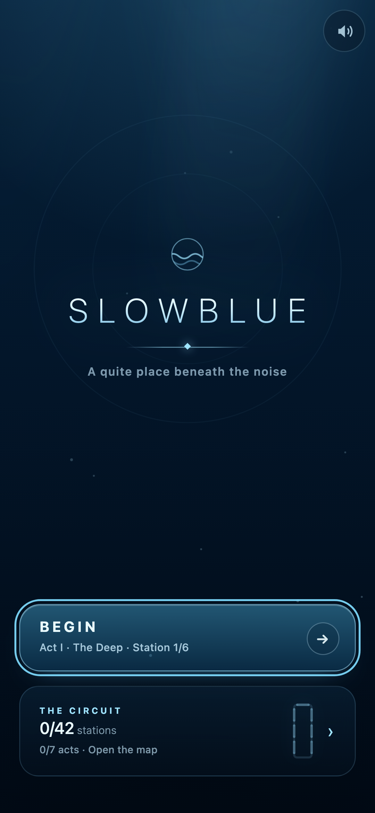
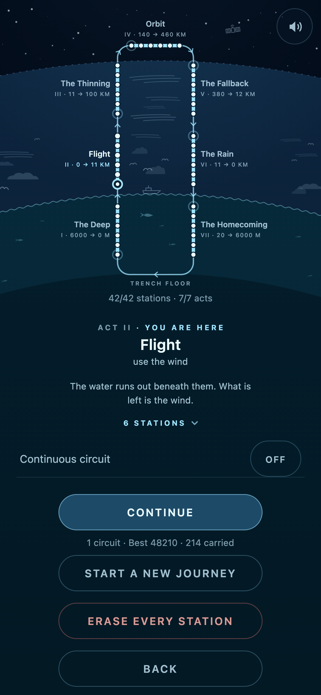
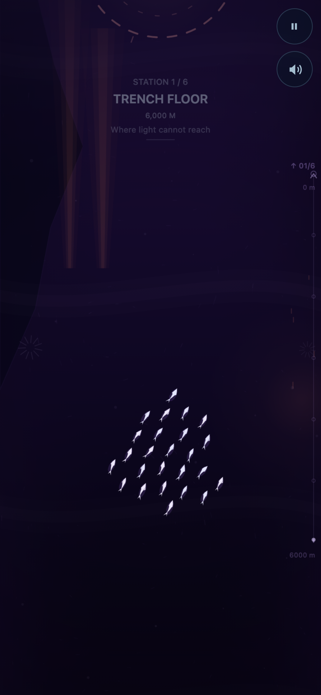
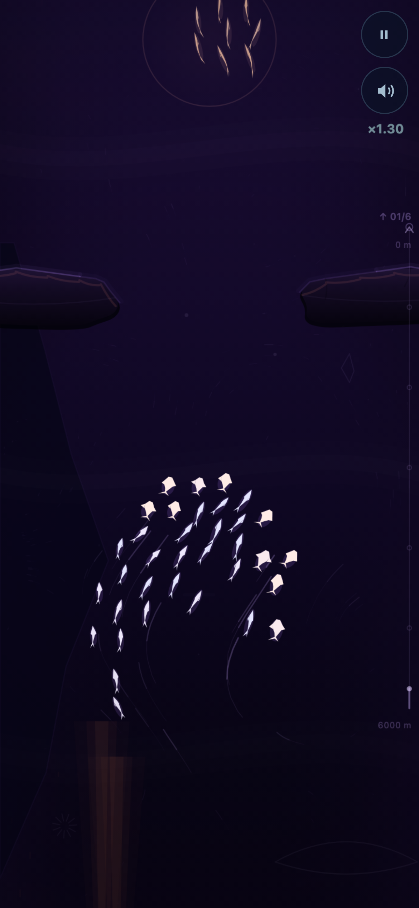
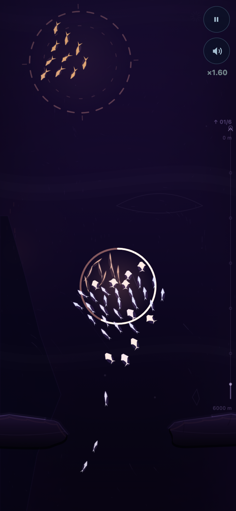
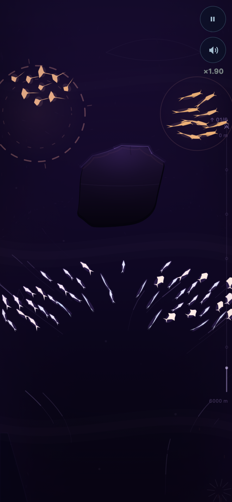
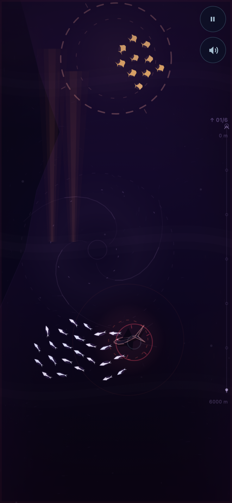
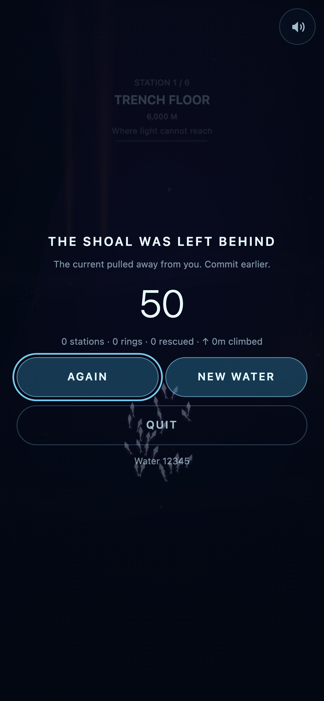
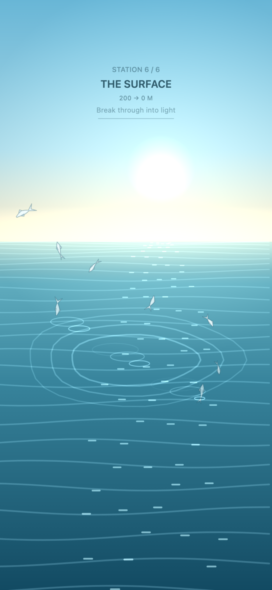

# Slowblue

**You do not control the fish. You control the ocean.**

A complete, mobile-first game. Drag the medium; the medium drags the life in it. Seven
acts, forty-two hand-built stations, no menus in the way of them — and it is built to be
watched as much as played: nothing clicks, nothing flashes, and the loudest thing on
screen is a ring asking to be filled.

It is not a climb. It is a **circuit**: sea, sky, upper air, orbit, re-entry, rain, sea
again, and the last frame is the trench floor the first one was shot on. The player is
told none of that. They find out when the water starts looking familiar.

[**Play it →**](https://horakdani.github.io/slowblue/) · open it on a phone, in portrait

[](LICENSE)

<p align="center"></p>

## Play it

It runs in a browser and nowhere else: no app store, no download, no account. Open
[the link above](https://horakdani.github.io/slowblue/) on a phone, in portrait. One
button, then you are in the water.

It installs, too: the production build ships a web manifest and an offline service
worker, so "Add to Home Screen" gives a full-screen game that runs with no signal.
Nothing is ever uploaded — **there is no network code in this project at all**, which
is also why there is nothing to agree to before playing.

## Run it yourself

```bash
npm install && npm run dev
```

Open the printed `http://<your-lan-ip>:5173` on a phone (the dev server binds to all
interfaces).

```bash
npm run build      # production build into dist/
npm run preview    # serve that build on :4173
npm run verify     # the gate: lint + typecheck + unit + build + e2e
```

The build is served from the domain root by default. To host it under a path — which is
what GitHub Pages does to a project site — pass the path in:

```bash
BASE_PATH=/slowblue/ npm run build
```

That is how the published site is built, and `npm run deploy` is the whole of it: it
builds with that path, drops the sourcemaps nothing refers to, and force-pushes the
result as a single commit on the `gh-pages` branch, which is what Pages serves. There is
no deploy workflow — pushing one would need an OAuth scope this repo was set up without —
so a change to `main` is not live until someone runs that command.

Everything that has to agree with that reads it rather than repeating it: the service
worker takes its own location, the manifest's URLs are relative to itself, and the
precache list is written by a build plugin out of vite's `base`.

## Play

* **Drag** to lay a current. Slow drag = wide and weak, fast flick = narrow and strong,
  circle = vortex, drag against the shoal = brake. Same rule for all of them.
* **The ocean already moves.** Faint streaks show its current. The line you set up three
  seconds ago is not the line you are on any more — read the water, ride it or fight it.
* Steer the shoal through the gaps. Hitting rock costs individuals *and* panics the fish
  around the impact, so a careless run comes apart faster than you expect.
* **A dashed ring is mandatory.** Hold enough of the shoal inside one for half a second and
  those fish join you; let the water carry it off the bottom of the screen and the dive is
  over. Dashed rings always sit on the line the section already asks for, they are wider
  than they need to be, and **the ocean eases off while you are working one** — the one
  place in the game that asks you to stop is the one place time relaxes.
* **A thin unbroken ring is optional.** Same mechanic, no penalty, more fish. Every ring
  holds a **different kind of fish** — darts, stubby discs, needles, fan-tails, rays, and
  broad-headed catfish trailing their barbels — and they keep their own shape once they
  join you, so a big shoal is visibly one you assembled.
* A rock has a ring on **both** sides. Split the shoal around the rock and pull it back
  together to take both — that pays extra.
* **Keep them together.** Clear a section without letting the shoal come apart and the
  score multiplier climbs, up to ×3.4. One botched section resets it.
* The hairline at the right edge is the act you are in: six station nodes, a fill that
  never resets, and a dot travelling the act's own span — which runs *down* in the three
  acts that fall.
* You lose when a dashed ring is left behind, when the swarm falls below 40 % of what you
  started with, or when it gets left behind by the medium — **in the first two acts.**
  From act III on, that costs the *station* instead: it begins again, for time and a sixth
  of the banked score, and the journey survives. Act IV cannot end a campaign at all, and
  the last three stations of act VII cannot be lost in any sense.

## The circuit

Seven acts, six stations each (act I has six across forty-two authored sections), and one
sentence holding all of them: **you never touch an individual.** What changes between acts
is not the gesture but what the medium *answers* — and the medium is a single number,
its density, which is also the difficulty curve, the palette and the sound.

| # | Act | Carrier | Medium | Your verb |
| --- | --- | --- | --- | --- |
| I | **Mélység** / The Deep | a shoal | water | herd them |
| II | **Repülés** / Flight | a flock | air | use the wind |
| III | **Ritkulás** / The Thinning | spores and ice | thin, layered air | wait, and choose a layer |
| IV | **Keringés** / Orbit | golden motes | none — gravity | aim ahead of them |
| V | **Visszatérés** / The Fallback | meteor dust | vacuum → plasma → air | brake, and accept the medium |
| VI | **Eső** / The Rain | crystals, then drops | cloud, rain, river | gather them |
| VII | **Hazatérés** / The Homecoming | plankton and marine snow | water again | let them settle |

Acts I and II end on films: the shoal breaks the surface into daylight, and the flock
levels off at the top of the weather and releases what it was carrying. Act IV ends on the
one shot in the game that moves the camera.

### Act I — the sea (6000 m → 0 m)

| # | Depth | Station | Environmental turn |
| --- | ---: | --- | --- |
| 1 | 6000 m | **Árokfenék** / Trench Floor | Canyon walls, mineral heat and almost no living light. |
| 2 | 4000 m | **Fekete víz** / Black Water | The walls fall away into an empty abyss. |
| 3 | 2500 m | **Éjféli sodrás** / Midnight Current | Long upward currents begin to carry the field. |
| 4 | 1000 m | **Kék emelkedő** / Blue Rise | Cold blue replaces black; the first living colour returns. |
| 5 | 200 m | **Fényhatár** / Light Line | Plant life and cyan water announce that daylight is close. |
| 6 | 0 m | **Felszín** / The Surface | Rays, bubbles and a visible waterline; completion is the breach into light. |

### Act II — the air (60 m → 11 km)

The ascent does not stop at the waterline, and **it is the same game**: you still lay the
medium and the life in it follows. Air grips a third less, so a stroke persuades a flock
where the same stroke shoves a shoal; a laid gust lasts half again as long, because there
is nothing up here to dissipate it; and the wind is faster than any current, so falling
behind it is the clock.

The flock is **birds** — one silhouette, one colour, no markings — and they beat their
wings the whole way. They bank into their turns, they surge on the power stroke, no two
are at the same point of the same beat, and every ring you hold adds a species with a
visibly different wing. Everything you fly around is cloud, and cloud does not make rock's
shapes. What hunts you tells you it has committed by *folding*.

| # | Altitude | Station | What changes |
| --- | ---: | --- | --- |
| 1 | 60 m | **Permet** / The Spray | Sea haze and torn shreds of cloud; the sea sinks out of the frame. |
| 2 | 300 m | **Partfal** / The Cliff | Orographic cloud, and the first rotor. |
| 3 | 1 200 m | **Gomolymező** / The Cumulus Field | The fair-weather deck, seen across the tops rather than from under it. |
| 4 | 2 500 m | **Vonulás** / The Passage | A real cloud street, held for six hundred pixels, and the first raptor. |
| 5 | 4 000 m | **Zivatar** / The Squall | Rain, and the first air that turns. |
| 6 | 11 000 m | **Üllő** / The Anvil | Out of the top of the weather. A raptor that stoops from behind, one that waits, and the end of the air. |

**The act stops at eleven kilometres, and that is load-bearing.** Nothing with wings has
ever flown at 82 km, because there is no air there to fly in — a bird at the mesopause is
the one image in this campaign that would tell the player the world is made up. The anvil
is where weather stops, and it is where the flock has to hand over.

### Acts III–VII — the rest of the circuit

Above the anvil the carrier stops being an animal. What goes up is what a bird was
*carrying*, and from there the cargo is spores, then the gold itself, then meteor dust,
then water, then plankton — five ways of being a particle rather than five species.

* **III Ritkulás** (11 → 100 km). The upper atmosphere separates into deep bands moving at
  very different speeds and in opposite directions. A stroke barely grips; being in the
  right band is worth more than any stroke. A gravity wave runs on the 11-second breath.
* **IV Keringés** (100 km → orbit). No medium at all: a stroke lays a **gravity well**
  instead of momentum, motes move ballistically, and a bad stroke is correctable but not
  quickly. It ends at **Rálátás**, where the camera turns for the first and only time and
  the entire atmosphere — everything the game has happened in — resolves into one bright
  line a few pixels thick.
* **V Visszatérés** (orbit → upper air). The input blends continuously from gravity back to
  momentum as the air arrives. The danger is not death: it is scatter and a bad angle. It is
  also the one act where the world does not stand still — gaps that breathe, masses that
  walk, and **the ember**: a burning piece of the vehicle that ablates more slowly than the
  swarm does and therefore overtakes it. Nothing hunts at two hundred kilometres, so act V's
  threat is not an animal and does not steer. And it is the one act where **the air has a
  speed**: outrun it and the swarm starts to burn away from the front. The act's verb is
  *brake, and accept the medium*, and going fast is available to anyone who watches the
  frame's leading edge for the moment it goes warm.
* **VI Eső** (cloud → the sea). The rescue rings take a new meaning — they gather scattered
  droplets back. *Üllő alulról* is the same cloud act II climbed over, from below.
* **VII Hazatérés** (surface → 6000 m). Not act I reversed, and no longer authored out of
  act I's rock: the carrier drifts rather than swims, what it drifts past is soft and
  alive, hazards thin out and stop, and **the second half cannot be lost at all.**

After the circuit closes: **continuous circuit mode** — the seventh act hands back to the
first and the one dialog in the journey goes away — and the best score and preserved mass
for the whole journey.

The circuit was an hour — seven acts of roughly ten minutes — and it has been rebuilt.
**432 sections and 144 authored minutes now, which is about 108 as played**: six acts of
twenty-odd minutes each, and act I frozen at ten because it is the metronome the other six
are heard against and a player meets it with nothing learned yet.

What was wrong was never the hour. It was that acts I and II asked something every seventeen
seconds and act IV every fifty-five, and that all six hazards in the game with any intent in
them were in the first two acts. Length came from more sections at exactly the same pace —
`pace` does not rise anywhere, and gap widths do not tighten. Difficulty came from four
things a section can now ask that it could not before: a gap that breathes open on the
breath's own eleven seconds, a mass that walks sideways while you close on it, two of those
walking against each other so the lane between them is never straight, and two breathing
gates where the second is shut while the first is open.

Act V was the pilot and was flown three times, and each playthrough found something the
numbers had not. The first doubling came back *not harder, not longer* — both true: one act
in seven is six real minutes on the hour, and every section it gained was another instance of
a shape the act already had. The third found the one that had been true since the campaign
first turned over: **the fall was free.** The camera takes the greater of its own drift and
the swarm's position, so a hand that pushes forward drags the world along with it and can
never be left behind. The answer is not the camera, it is the air: past a terminal speed the
medium takes the swarm apart from the front, and *braking* becomes the thing the descent was
always claiming to be about.

See [docs/DESIGN-LENGTH.md](docs/DESIGN-LENGTH.md) — including the part where the first build
measured five times worse than the act it replaced, the part where a hand that pushes hard
and watches the frame beats both a careful one and a blind one, and the part that says nobody
has played any of it yet.

### The map

The title screen says "seven acts, one circuit, from the floor of the trench back to it"
and for a long time nothing ever *showed* it. **A kör / The Circuit** is one screen behind
one button, and it is a dial: forty-two marks around one closed ring, seven bands of it
for the seven acts. Where it starts is where it ends, because it is the same place — on a
ring that is not a claim, it is the geometry.

<p align="center"></p>

* **What is done and what is left.** The flown part of each band is lit and the rest is
  an outline; every station is a mark on the line, filled once it is behind you.
* **Where you are**: one bright point on the ring, at the station a put-down circuit will
  resume from, and a lit numeral on the act it is in.
* **The middle is the only writing on the screen** — the selected act's numeral, name, the
  verb for what your hand does in it, and its six stations as six dots. Pressing a marker
  moves the middle; the button under the ring plays what the middle shows. Selecting is
  not starting: seven markers on a circle are seven small targets.
* **An act is open once you have *arrived* at it**, never as a reward for a score, and the
  stations it names are a record rather than a level select — the campaign checkpoints at
  station boundaries, but a checkpoint is where you *resume*, not somewhere you can be
  dropped into out of order.
* Altitude comes along for nothing. The campaign climbs for four acts and falls for three,
  so placing the stations in play order puts the trench at the bottom of the circle and
  orbit at the top without the ring ever being told what a metre is.

The button appears as soon as there is any journey to look at, and carries the one number
the title screen has ever needed — `A KÖR · 24/42`.

Nothing in any of it is procedural, and nothing in it can be impossible: every section is
checked by a corridor sweep that carries the swarm's real lateral reach down the whole
course in the act's own direction, and every mandatory ring has to intersect it. The sweep
also carries the question the player actually asks — **can one body take them all, in
order** — by re-seeding itself at each compulsory ring and running forward to the next,
which is the check that stops a course with two ways round something from approving a ring
in each. See [IMPLEMENTATION_NOTES.md](IMPLEMENTATION_NOTES.md) and
[docs/DESIGN-ASCENT.md](docs/DESIGN-ASCENT.md).

### Seven acts, seven rhythms

For a long time the acts differed in everything except the two things a player feels every
ten seconds. Sections were 820 px apart in all seven of them, every station closed on the
same empty breath, and 92 of the campaign's hundred obstacle sections carried one
compulsory ring on the section's own centre line about 200 px behind it. Different
alphabets, one metronome and one reward — which is a way of playing the same act with the
background changed.

Both are per-act now, and neither cost a line of engine code:

| act | its rhythm | where the reward sits |
| --- | --- | --- |
| I · The Deep | the metronome, unchanged — it is frozen, and it is what the others are heard against | one ring, on the line |
| II · Flight | legs and rests: two things inside one weather system, then a long crossing | in the middle of the corridor you are being asked to hold |
| III · The Thinning | the drift comes first: a long empty arrival, then two decisions 420 px apart | wide and rare, and at the door you chose |
| IV · Orbit | gravity clusters: a long fall, then two wells close enough to be one curve | never on the line you are already on |
| V · The Fallback | contraction — the medium schedule, drawn in pixels, down to 560 px in the plasma | two rings on one line, because the danger is scatter |
| VI · The Rain | squalls: 380 px, then 1400, then 380 | a run of three, taken in sequence — gathering as a phrase |
| VII · The Homecoming | dilation, monotone, to a stop | fewer, wider, and it stops asking where the failure does |

Act VII also stopped being act I with the lights down. It was authored end to end out of
the trench's rock while its own file insisted it was not act I reversed; below the sunlit
zone almost nothing in the ocean is hard, so it now has two shapes of its own — a
**siphonophore** hanging in strands along the course, and a **bloom** of medusae with more
open water in it than body — and **nothing in the act closes the course**. The one stone
left is at the salt line, where act VI's brook arrives. Stone, then jelly, then nothing.


## Controls beyond the finger

| Input | Effect |
| --- | --- |
| `Esc` | Pause, or back out of a screen |
| `P` | Pause / resume |
| `R` | Restart the same water |
| `Space` / `Enter` | Dive in, from the title |
| `D` | Debug panel (once it has been opened with `?debug=1`) |

## Where the controls are

There is no settings screen. There was, and it was a list of eleven things nobody had gone
looking for, sitting behind a button on the title screen. Everything on it either moved to
the place it is actually about or stopped being a question:

| | |
| --- | --- |
| **Sound** | The button on the glass, top right, on every screen. In a run it opens the mixer — the layers of the act you are standing in, named for what they are in that act. Everywhere else it is a mute, because everywhere else the ten faders are the wrong question and the bed is still playing. |
| **Continuous circuit** | The circuit map, above the button that starts water. It changes what the game *is*, so it is chosen where the run is committed to. |
| **Erase every station** | The foot of that same map, under the picture of the forty-two it destroys. |
| **Render quality** | Measured, not asked. See below. |
| Haptics, HUD, language, comfort | Gone. The buzz was a row nobody stopped on; the HUD switch turned out to hide the warning that a run is being lost; the game ships in English; and COMFORT's two switches — high contrast and reduced motion — were removed along with the screen they sat on. |

### The picture budget

Nothing chooses this any more. `adaptQuality` in `src/main.ts` watches the frame rate and
walks a five-rung ladder, cheapest loss first: the particle budget is thinned twice before
the resolution is touched at all, because a phone that has lost some of its marine snow
still looks like this game and a phone rendered at 0.7 looks like a photograph of it. It
climbs back too — down at 45 fps after two and a half seconds, up at 58 after eight — so one
hot afternoon does not spend a step of quality for the rest of the session.

### The mixer, and the eight beds

Six of the ten tracks are the **bed** — the body of the medium, the medium in motion, the
chord, the layer above, the bell, and the far voice — and the other four are the game
talking: your hand, objective cues, danger, and the interface. Each has its own mute and
its own level.

The six bed tracks are *roles*, and what fills them is the act you are in. Every act has a
bed of its own (`src/audio/Beds.ts`), and every voice in it is a physical model with its
own file and its own tests:

| act | body | in motion | above | far |
|---|---|---|---|---|
| I · The Deep | bubbles, from a radius | — | surface shimmer | whale song |
| II · Flight | wingbeats | gusts | high wind | distant thunder |
| III · The Thinning | ice crystals | layer shear | nacreous halo | infrasound |
| IV · Orbit | your breath | your heartbeat | the ring of silence | whistlers |
| V · The Fallback | the plasma sheath | shock waves | ablation sparks | sonic boom |
| VI · The Rain | raindrops | the shower | leaf patter | thunder |
| — · The Brook | the riffle | the current | ripples | stones on the bed |
| VII · The Homecoming | sinking bubbles | marine snow | the fading light | the near whale |

Three of those are the same equation. A raindrop's plink, a brook's burble and a bubble at
forty metres are all Minnaert resonance — `f0 = 3.26 / r` — at 0.3 mm, 1 mm and 6 mm, and
no two of them are mistakable for each other. The brook is an eighth bed rather than an
eighth act because it is the *seam*: act VI ends in running water and act VII begins in it.

**During a run there is a second button on the glass** (`≋`, under pause) that opens the
mixer for the act you are standing in, named for what that act is actually made of. It does
not pause: the bed goes on playing underneath it, because the only way to set a level is to
hear it.

### The rescue, per act

The dashed ring is the campaign's only reward, so it is voiced per act too
(`src/audio/Rescues.ts`) — an interval in the same pentatonic, and **the act's own material
converging**. Six wingbeats close up in the air, nine raindrops collapse onto the ring in
the rain, ten small bubbles fold together in the brook, five flakes of marine snow drift in
on the way home. Everything else in the engine that plays a handful of grains at once
spreads them outward; this is the one place they come together.

Six of the eight open upward. Act VI's band falls instead, because rain does not open — it
lands — and act VII's interval falls as well, the only reward in the game that descends.
Act IV has no material and no band at all: §13 leaves breath, heartbeat and a fine internal
resonance up there, so its reward is the ring of silence briefly becoming a chord, with
nothing struck, because nothing up there can be hit. The held shimmer while you are filling
a ring is the act's too — a fifth in the sea, two octaves higher and narrower in the upper
air, a fourth and very low on the way home.

### The breath, and the bubbles

The game breathes: one 11-second cycle, 5.45 breaths a minute, with a longer exhale than
inhale. The light gains a little on the way in, the edges close a little on the way out,
and the water opens and closes with it. Best with headphones.

The water is bubbles, not noise. Each one is a Minnaert resonator — the pitch, the length
and the loudness all come from a bubble radius, so nothing picks a frequency — and the
radius comes from how deep you are: big, low and slow on the trench floor, small and bright
near the surface. They come a little faster on every out-breath.

## URL parameters

| Parameter | Effect |
| --- | --- |
| `?seed=12345` | The first run of the session plays that exact water |
| `?debug=1` | Show the tuning panel and the stats overlay (`d` toggles it from there). Asked for rather than assumed, in `npm run dev` exactly as in a build: most of the work here is looking at the picture, and it cannot be judged through forty sliders. |
| `?admin=1` | Show the admin surface (also `a` on a keyboard, always on in `npm run dev`) |
| `?act=air` | Boot straight into one act: `water`, `air`, `thin`, `orbit`, `reentry`, `rain`, `home`. A run opened this way advances no circuit and touches no record. |

## Admin surface

Every authored thing in the game, one tap away, on the device it is being felt on. Three
tabs:

* **Pályák** — all forty-two stations of all seven acts. One tap starts the run *on* that station:
  right act, right medium, right palette, right banner, from its first section.
* **Részpályák** — every authored section on its own, listed with what it carries (rings
  and which are mandatory, rotors and their strength, raptors). One tap
  opens a run on that section, so a narrows is a run that *starts* on a narrows.
* **Hangok** — every sound the engine makes, fired by hand: nineteen event cues, the seven
  act endings, and the bed voices of whichever of the eight beds is selected — only those,
  because a button that plays a whale while the orbit bed is up is a tool that lies about
  what the game does. They otherwise schedule themselves and cannot be *examined* by
  playing (a whale is once or twice a minute by design; an infrasound swell is once or
  twice in five). Over sliders for the bed, its arc, stereo position and ring-hold, because
  most of those sounds are parameterised by where you are rather than by what happened. The
  endings are their own group because they are the only sounds in the game you cannot
  otherwise hear without finishing a ten-minute act — and because they run up to fourteen
  seconds each, so they are worth playing one at a time.

The clock freezes while the sheet is open, a muted mixer track is marked as such (with one
button to bring them all back), and **a run started from here is never written to your
personal bests** — jumping to the last station and finishing it is not a campaign flown.

## Debug / tuning panel

Live sliders for all 30 physical parameters (flow strength, radius, decay, diffusion,
speed ceiling, turbulence, coupling, ambient strength and ramp, alignment, cohesion,
separation, avoidance, migration, speeds, accel, agent count, world speed, pressure ramp,
inertia per agent, rescue ring radius and commitment, vortex strength, hunter speed,
hunter water coupling, flight response). Plus: velocity-field and spatial-hash overlays,
FPS and frame time, seed replay, config export/import, defaults reset, slow motion and
pause, and telemetry export. Values persist in `localStorage`.

## Local measurement

Every run is recorded locally and can be exported as JSON from the panel: time to first
interaction, run length, restart latency, gesture count and mean length, gates cleared,
individuals rescued and lost, mean shoal spread, seed repeats, FPS and slow-frame ratio.

## Commands

```bash
npm run dev        # dev server
npm run verify     # lint + typecheck + unit tests + production build + e2e
npm test           # unit tests + headless playability probe
npm run sweep      # design-health table (scripted players, minutes not seconds)
npm run e2e        # mobile-viewport smoke tests
npm run screens    # ...and regenerate the screens below (the only thing that writes them)
npm run build      # typecheck + production build
npm run icons      # regenerate the PWA icons (no image dependencies)
```

The e2e suite previews the production build on **port 4173** and, by default, reuses a
server that is already answering there. That check can only ask whether *something* is
listening, not whether it is this game — so if another project is squatting the port, the
whole suite silently runs against the wrong page and times out five minutes at a time.
Move it out of the way:

```bash
SLOWBLUE_E2E_PORT=4271 npm run e2e
```

Naming a port also turns reuse off, and the preview now starts with `--strictPort`, so a
collision fails immediately instead of drifting to the next free port and leaving
`baseURL` pointing at whatever was already there.

`npm test` includes two headless probes. The *playability probe* runs scripted stand-in
players (passive, panic-flicker, late-flicker, early-steerer, pod-chaser, shoal-splitter)
over **generated** water — water nobody has hand-tuned, which is the only honest place to
ask whether skill tiers separate, whether taking an optional ring is a choice, and whether
splitting the shoal is a scoring verb. The *campaign probe* plays the authored levels and
asks the one question that matters there: a competent stand-in player clears the first
level on every seed, a player who refuses a dashed ring loses to that and to nothing else,
and every failure ending stays reachable. Every balance number in
[IMPLEMENTATION_NOTES.md](IMPLEMENTATION_NOTES.md) came out of `npm run sweep`, not out of
taste; three plausible hypotheses were falsified there before the real fix was found, and
one silent scoring bug was caught by it.

`npm run sweep` also asks whether an act can be *finished*, on the act's own clock rather
than in a fixed budget — every other sweep compares acts at 300 seconds, which is half of
one. Four of the seven finish on every seed. Acts I and II did not, because they were then
the two that ended a run rather than restarting a station, and the scripted hand is not
good enough to fly forty-two sections unstranded — a fact about the bot rather than about
the acts. That reading predates the unified failure rule below and has not been re-taken.
**Act IV
reported 0/11 for the life of the act, and that turned out to be a fact about one
character**: `debrisArc` negated its bow, so every orbital gate was built as the mirror of
the shape five separate comments describe, and the act's one escalation axis ran backwards.
With the sign the right way round, a symmetric funnel at the Umbra and a real ramp step at
A kút, it is 6/11 — still a scripted hand scraping through rather than an easy act, so its
completion is still checked by playing it. See §18 of
[DESIGN-ASCENT.md](docs/DESIGN-ASCENT.md).

## Screens

| | |
| --- | --- |
|  |  |
|  |  |
|  |  |

The surface, which is the only thing the whole ascent is for:

<p align="center"></p>

See [IMPLEMENTATION_NOTES.md](IMPLEMENTATION_NOTES.md) for architecture, tuning points,
measurements and the deliberate compromises.

## Held to a store's standard without being in one

There is no app-store packaging in this repo and none planned — the web is the target, and
an installable PWA is the whole of the distribution story. The questions a store would ask
are still worth answering, though, and they are answered rather than assumed:
[docs/EDITORIAL.md](docs/EDITORIAL.md) walks the Today tab and Editors' Choice checklists a
line at a time, where every verdict is a number, a file, or the word `unmeasured` — and its
open items are at the top rather than the bottom.

## Contributing

Bug reports, device reports and balance arguments are all welcome; see
[CONTRIBUTING.md](CONTRIBUTING.md) for the gate a pull request has to pass and the
decisions that are already settled. Taking part means agreeing to the
[Code of Conduct](CODE_OF_CONDUCT.md).

## License

[MIT](LICENSE). © 2026 Daniel Horak.
